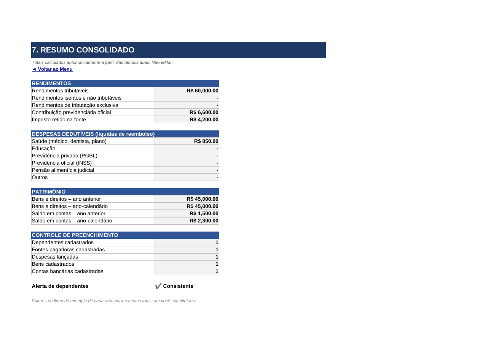

# 📊 Agregador de Dados para Declaração de Imposto de Renda (Excel)

Projeto desenvolvido como desafio do bootcamp da **[DIO](https://www.dio.me/)**: uma ferramenta construída inteiramente no **Microsoft Excel** para organizar, validar e consolidar as informações necessárias à Declaração de Imposto de Renda da Pessoa Física (IRPF).

> ⚠️ Ferramenta de **organização pessoal**. Ela não substitui o programa oficial da Receita Federal nem calcula o imposto devido.

---

## 🎯 Objetivo

Reunir, em um único arquivo, todos os dados que normalmente ficam espalhados em informes, extratos e recibos — com **menu de navegação**, **validações automáticas**, **listas suspensas**, **resumo consolidado** e **links rápidos** para os serviços da Receita Federal.

---

## 🗂️ Estrutura do repositório

```
agregador-irpf-excel/
├── README.md                         ← esta documentação
├── planilha/
│   └── Agregador_IR.xlsx             ← a ferramenta
├── vba/
│   └── script_de_alinhamentos.bas    ← macro de apoio para alinhar ícones do menu
└── images/                           ← capturas de tela
```

---

## 🧭 Abas da planilha

| Aba | Função |
|---|---|
| **MENU** | Tela inicial com botões (hiperlinks) para todas as seções e legenda de cores |
| **DADOS_PESSOAIS** | Identificação do declarante: nome, CPF, nascimento, endereço, contato, ocupação |
| **DEPENDENTES** | Cadastro de dependentes com parentesco (categorias da Receita) e idade calculada |
| **RENDIMENTOS** | Fontes pagadoras, tipo de rendimento, valores, contribuição previdenciária e IR retido |
| **DESPESAS** | Despesas dedutíveis (saúde, educação, previdência, pensão) e reembolsos |
| **BENS_DIREITOS** | Bens por grupo, com situação em 31/12 do ano anterior e atual e variação automática |
| **CONTAS_BANCARIAS** | Contas com banco escolhido da lista oficial de códigos (COMPE) e saldos |
| **RESUMO** | Totais consolidados por fórmulas + controle de preenchimento + alerta de consistência |
| **LINKS_UTEIS** | Atalhos para Meu IR, programa IRPF, e-CAC, situação do CPF e restituição |
| **APOIO** | Tabelas de apoio (bancos, parentescos, tipos) usadas nas listas suspensas |

Todas as abas têm um link **"◄ Voltar ao Menu"** no topo.

---

## ⚙️ Recursos do Excel aplicados

### 1. Menu de navegação
- Botões criados com **hiperlinks internos** (`Inserir > Link > Colocar neste documento`).
- Link de retorno ao menu em cada aba, garantindo navegação sem rolagem.
- Macro VBA opcional (`vba/script_de_alinhamentos.bas`) para posicionar ícones com precisão.

### 2. Validação de dados
| Campo | Regra |
|---|---|
| CPF | Personalizada: `=E(NÚM.CARACT(B6)=11;ÉNÚM(--B6))` → 11 dígitos numéricos |
| CNPJ/CEP | Mesmo princípio, com 14 / 8 dígitos |
| Datas | Entre 01/01/1900 e `HOJE()` — sem datas futuras |
| Valores (R$) | Decimal ≥ 0 |
| E-mail | Deve conter `@` e `.` |
| Agência | Comprimento de texto de 1 a 6 caracteres |
| Banco, parentesco, tipo de rendimento, tipo de despesa, grupo de bem | **Listas suspensas** ligadas a **intervalos nomeados** da aba APOIO |

Cada validação exibe **mensagem de entrada** (orientação) e **alerta de erro** personalizado.

### 3. Intervalos nomeados
`Bancos`, `Parentesco`, `TipoRendimento`, `TipoDespesa`, `GrupoBem`, `TipoConta`, `SimNao` — facilitam a manutenção: basta atualizar a aba APOIO.

### 4. Fórmulas
- `SOMASES` para totalizar rendimentos e despesas por tipo (despesas líquidas de reembolso).
- `DATADIF(...;HOJE();"a")` para idade automática.
- `CONT.VALORES` para controle de preenchimento.
- `SE` aninhado para checar coerência entre "Possui dependentes?" e o cadastro de dependentes.
- Indicador visual de formato do CPF (✔ / ✘).

### 5. Interface amigável
- **Células amarelas com texto azul** = campos de entrada; **células cinza** = fórmulas.
- Cabeçalhos congelados, linhas de grade ocultas, abas coloridas.
- Formato monetário `R$` e uma **linha de exemplo** em cada tabela.

---

## ▶️ Como usar

1. Baixe `planilha/Agregador_IR.xlsx` e abra no Excel.
2. Na aba **MENU**, clique na seção desejada.
3. Substitua a linha de exemplo pelos seus dados e preencha apenas as células amarelas.
4. Confira os totais na aba **RESUMO** e use-os ao preencher o programa oficial da Receita.
5. *(Opcional)* Para usar a macro: `Alt + F11` → `Arquivo > Importar arquivo` → selecione o `.bas` → salve como `.xlsm`.

---

## 🖼️ Capturas de tela

### Menu de navegação


### Resumo consolidado


---

## 💡 Aprendizados

- Planejar a **estrutura da informação** antes de construir torna a planilha muito mais fácil de manter.
- **Validação de dados + intervalos nomeados** são o que transformam uma planilha comum em uma ferramenta confiável: evitam erros na origem.
- Separar **entradas, cálculos e tabelas de apoio** em áreas/abas distintas deixa a ferramenta clara para qualquer usuário.
- O **GitHub** é uma ótima vitrine para documentar projetos que não são apenas código.

## 🚀 Melhorias futuras

- Validação completa dos dígitos verificadores do CPF via VBA.
- Proteção das abas e células de fórmula com senha.
- Dashboard com gráficos de evolução patrimonial.
- Botão de exportação do resumo em PDF.

---

## 👤 Autor

**Douglas de Sousa Rezende**
Inspetor de Ensaios Não Destrutivos (aviação) · Estudante de Engenharia de Produção

[](https://github.com/SEU_USUARIO)
[](https://www.linkedin.com/in/SEU_PERFIL)
